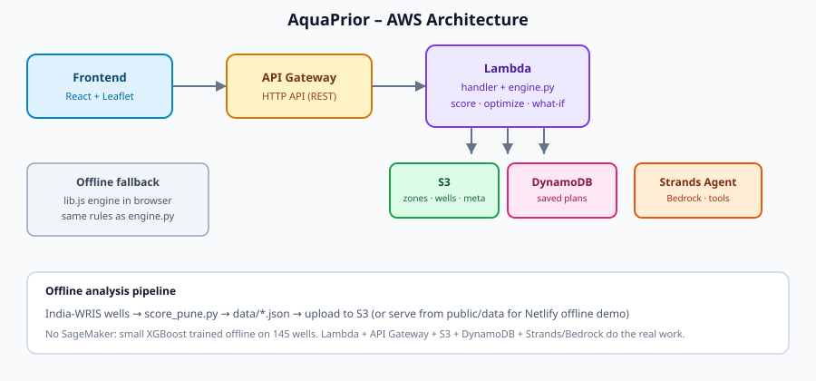
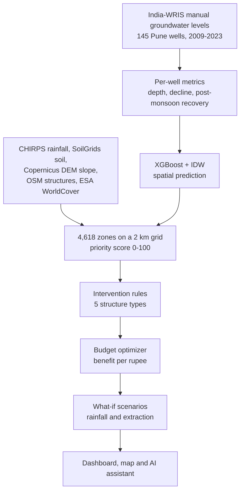
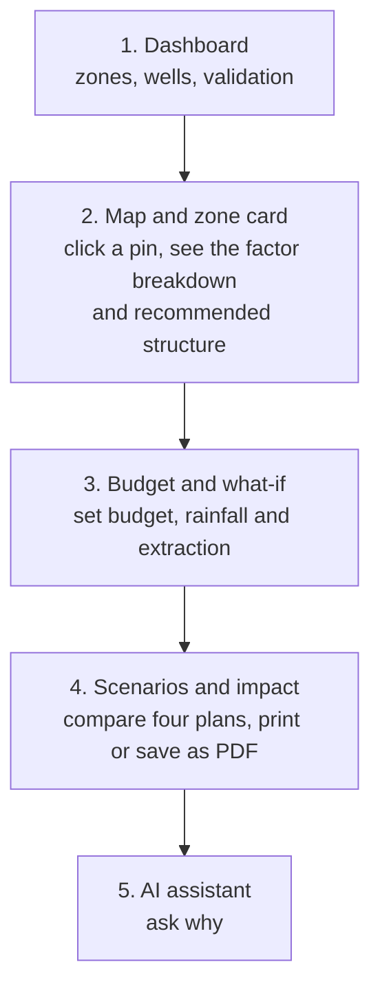
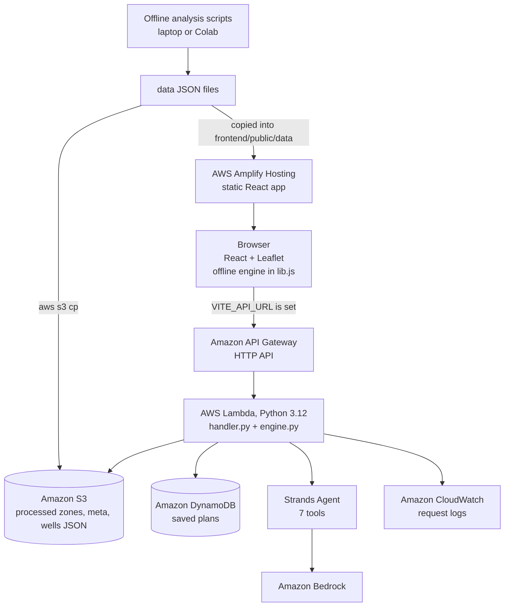

# AquaPrior

**Find where groundwater recharge matters most. Then make a limited budget go further.**

AquaPrior is an explainable decision-support web application for **groundwater recharge planning** in the **Pune region, Maharashtra**.

- It combines real India-WRIS well records with rainfall, soil, slope, existing water structures and a land-use demand proxy, and gives each of **4,618 zones** (a 2 km grid) a **priority score from 0 to 100**.
- It recommends one of five recharge structures for every zone, with an estimated cost and benefit.
- It picks the best set of projects for a **fixed budget**, runs **what-if scenarios** (budget, rainfall, extraction) and shows the plan on a map.
- An **AI assistant** (AWS Strands Agents SDK on Amazon Bedrock) explains every ranking in plain language, using only numbers returned by the analysis engine.

The app works in two modes: **offline demo mode**, where the full engine runs in the browser with no setup, and **AWS mode**, where the same engine runs behind API Gateway and Lambda and the assistant is powered by Bedrock.

Built for the **AWS Environmental Hackathon** by WeMakeDevs. It uses AWS Amplify, API Gateway, Lambda, DynamoDB, S3, Bedrock (through the Strands Agents SDK) and CloudWatch.

**Live Demo:** [Open AquaPrior](https://main.d3vogdz4k7ydfh.amplifyapp.com/)

<!-- Add your demo video link here: **Prototype Video:** [Watch the Demo](LINK) -->

> **AquaPrior is decision support, not a groundwater forecast.** Scores rank *relative* priority for field investigation. Costs and benefits are illustrative placeholders. Final decisions need a hydrogeologist and a field survey.



## The problem

- **Recharge money is limited.** Governments, NGOs and village groups can fund only a few check dams, pits, tanks, wells or farm ponds each year.
- **A map of low groundwater does not say where to build.** A depleted area on steep, hard ground may have little water to capture and little ability to let it soak in.
- **A good site is three things at once:**

  | Necessary | Suitable | Impactful |
  |---|---|---|
  | The water table is deep or falling | Soil, slope and land allow a structure | Rainfall and runoff supply water, and nothing already serves the area |

- **The evidence is scattered.** Wells, rainfall, soil, terrain and existing structures sit in different datasets and are rarely combined into one ranked, explainable shortlist.

## What AquaPrior does

| Screen | What it gives you |
|---|---|
| **Dashboard** | Study area, number of zones, High-priority zones, wells used, the score factors and their weights, model validation, and the top 10 zones. |
| **Map & zone** | Every zone as a pin coloured by tier (High, Medium, Low), real wells as ◆, and fading by data confidence. Click a zone for its score, rank, factor breakdown, measured depth and trend, recommended structure, cost, estimated benefit and the reasons. |
| **Budget & what-if** | Sliders for budget, rainfall change and extraction change. Shows the optimized project list, numbered pins on the map, change against the baseline, and how the top zones' scores shift. |
| **Scenarios** | Four plans side by side with a chart: Baseline, Budget constrained, Rainfall −20% and Extraction −15%. |
| **Impact summary** | Budget used, number of projects, share in High-priority zones, structure mix, project list with map links, and a **Print / save as PDF** button. |
| **AI assistant** | Ask why a zone ranks where it does, which three zones to prioritize, what to build with ₹10 lakh, or what happens if rainfall drops 20%. |

## Features

- **Transparent priority score.** Six factors with documented weights, a per-zone breakdown in points, and factors that are missing from the data skipped and flagged, never invented.
- **Real data.** 145 India-WRIS wells with at least six pre-monsoon years (2009-2023), spatially predicted onto a 2 km grid and validated on unseen wells.
- **Data confidence.** Zones far from a measured well are shown fainter and carry a "low data confidence" reason.
- **Five recommended structures:** Check Dam, Percolation Tank, Recharge Well, Farm Pond and Recharge Pit, chosen by transparent rules. Each recommendation lists its reasons.
- **Budget optimizer** with one project per zone, at least 3 km between projects and a cap so no single structure type takes more than 45% of the budget.
- **What-if simulation** for budget, rainfall and groundwater extraction.
- **Explainable assistant.**
  - Offline: a built-in assistant that handles about a dozen question types (zone explanations, comparisons, plans with budget and rainfall, "top 5 deepest", scenarios, method, accuracy, costs) plus a knowledge base for open-ended questions.
  - AWS mode: a Strands agent with seven tools and a guardrail prompt that allows only values returned by the engine.
- **Map links.** Every zone and project shows its latitude and longitude with an "open in Google Maps" link.
- **Honest by design.** The footer and notes state that scores rank relative priority and do not predict groundwater levels.

## How it works



**A typical session**



**The engine, in brief**

| Step | How |
|---|---|
| Priority score | A blend of an XGBoost model and inverse-distance weighting (IDW) over the well metrics, combined with the factor layers. Weights: groundwater stress 30%, recharge potential 20%, rainfall/runoff 15%, soil suitability 15%, water demand 10%, infrastructure gap 10%. |
| Well part of the score | 0.6 × stress (45% depth, 55% decline) + 0.4 × seasonal recovery. |
| Normalization | Each factor is scaled 0-1 inside the 5th-95th percentile range of the study area. If a layer is missing, its weight is dropped and the others are renormalized. |
| Tiers | **High** = top 20% of zones (924), **Medium** = next 30% (1,385), **Low** = the rest (2,309). Tiers are relative, not absolute. |
| Validation | Leave-one-well-out cross-validation on unseen wells: R² 0.178 (XGBoost), 0.199 (IDW), **0.255 (final blend)**. This is modest, so use scores to shortlist areas for a field survey. |
| Structure choice | Hand-written suitability rules per structure (see below), not a hydrological simulation. The highest-suitability structure is recommended. |
| Benefit | `base benefit × score/100 × (1 + rainfall change) × (0.5 + suitability) × (0.6 + 0.4 × data confidence)` |
| Optimizer | Greedy by benefit per rupee over the top 600 candidate zones, one project per zone, at least 3 km apart, and no structure type above 45% of the budget in the first pass (a second pass then spends what is left). It is **not provably optimal**. |
| What-if | Extraction change scales the stress factor and rainfall change scales the recharge-potential factor, both with an elasticity of 0.5. Rainfall also scales the benefit. These are scenario estimates under stated assumptions, not forecasts. |

**Structure rules and illustrative costs**

| Structure | Suitability rises with | Cost (₹ lakh) |
|---|---|---|
| Check Dam | falling water table, rainfall, steeper terrain, shallower water level | 8.5 |
| Percolation Tank | post-monsoon recovery, decline, soil infiltration, rainfall | 12.0 |
| Recharge Well | deeper water table | 3.2 |
| Farm Pond | flexible fallback (small bonus for recovery) | 4.5 |
| Recharge Pit | shallow water table and permeable soil | 1.5 |

Costs and base benefits live in `TYPES` in `backend/engine.py` and `frontend/src/lib.js`. **They are placeholders: replace them with local estimates** (for example your state's schedule of rates). Because the optimizer ranks by benefit per rupee, low-cost structures (pits and wells) win at small budgets with the current placeholder numbers.

**Example output** (offline engine, illustrative units, reproducible with `engine.compare`)

| Scenario | Budget | Projects | Spend | Est. benefit | Mix |
|---|---|---|---|---|---|
| Baseline | ₹20 lakh | 9 | ₹19.9 lakh | 44.6 | 6 Recharge Pit, 2 Recharge Well, 1 Farm Pond |
| Budget constrained | ₹10 lakh | 5 | ₹9.2 lakh | 21.9 | 4 Recharge Pit, 1 Recharge Well |
| Rainfall −20% | ₹20 lakh | 9 | ₹19.9 lakh | 33.8 | same mix, lower benefit |
| Extraction −15% | ₹20 lakh | 9 | ₹19.9 lakh | 42.8 | same mix, lower benefit |

## Architecture



| AWS service | Role |
|---|---|
| AWS Amplify Hosting | Serves the React web app (`frontend/amplify.yml`) |
| Amazon API Gateway | One HTTP API in front of the Lambda function |
| AWS Lambda | The API and analysis engine (Python 3.12, 1024 MB, 29 s timeout) |
| Amazon S3 | Holds the processed `zones`, `meta` and `wells` JSON under `processed/`, so re-scoring needs no redeploy (the Lambda falls back to bundled copies) |
| Amazon DynamoDB | `PlansTable`, on-demand capacity: saved plans |
| Amazon Bedrock + Strands Agents SDK | The assistant: a Strands agent with tools that call the engine |
| Amazon CloudWatch | One JSON log line per request |
| AWS SAM | Infrastructure as code (`backend/template.yaml`) |

There is no SageMaker: the model is a small XGBoost trained offline on 145 wells. `backend/engine.py` (server) and `frontend/src/lib.js` (browser) implement identical rules, so offline and AWS modes give the same plans.

## Run it locally (no AWS needed)

You need Node.js 18 or newer.

```bash
git clone https://github.com/mitansh-cmyk/Aqua-Prior.git
cd Aqua-Prior/frontend
npm install
npm run dev
```

Open the printed address (**http://localhost:5173**). The header badge shows **Offline demo mode**. An internet connection is needed for the map tiles.

To check the backend engine without AWS (Python 3.9 or newer, no packages needed):

```bash
cd backend
python -c "import handler; print(handler.lambda_handler({'requestContext': {'http': {'method': 'GET'}}, 'rawPath': '/health'}, None)['body'])"
```

This prints `{"ok": true, "zones": 4618, ...}`. Without the Strands SDK installed, the `/agent` route answers with the built-in rule-based assistant and says so in its `engine` field.

## Re-run the data pipeline (optional)

The outputs are already in `data/`. To rebuild them from the India-WRIS manual groundwater-level export:

```bash
pip install pandas numpy scipy scikit-learn xgboost
cd analysis
python score_pune.py --src /path/to/groundwater-level-collected-manually.csv
```

Then copy `data/zones.json`, `data/meta.json` and `data/wells.json` into `frontend/public/data/` and `backend/data/`, and rebuild the frontend.

The rainfall, soil, slope, structure and demand layers are produced by `analysis/colab_extras.py`, which is meant to run in Google Colab (about 10-25 minutes; the rainfall download is the slow part) and writes `extra_features.csv`. See [`docs/FEATURES.md`](docs/FEATURES.md) for the step-by-step.

## Deploy to AWS

You need:

- an AWS account and the AWS CLI configured,
- the AWS SAM CLI and Docker (the `strands-agents` package is large, so build with `sam build --use-container` if the zip is too big),
- **Amazon Bedrock model access** in your region (Bedrock console, Model access).

```bash
cd backend
sam build
sam deploy --guided          # creates the HTTP API, Lambda, DynamoDB table and S3 bucket
```

Then upload the processed data (`backend/deploy.sh` does this on Linux, macOS and WSL):

```bash
aws s3 cp ../data/zones.json s3://<DataBucketName>/processed/zones.json
aws s3 cp ../data/meta.json  s3://<DataBucketName>/processed/meta.json
aws s3 cp ../data/wells.json s3://<DataBucketName>/processed/wells.json
```

Finally, point the frontend at the API. Copy `frontend/.env.example` to `frontend/.env` and set:

```
VITE_API_URL=https://xxxx.execute-api.<region>.amazonaws.com
```

When the API is reachable, the header badge turns green (**AWS API connected**), the assistant uses the Strands agent, and a **Save plan to AWS** button appears and writes to DynamoDB. If the agent is unavailable, the app falls back to the local assistant and tells the user why.

Optional template parameter: `BedrockModelId` (leave it empty for the SDK default).

**Hosting the frontend:** push the repo to GitHub, connect the `frontend/` folder in AWS Amplify Hosting (build settings are in `frontend/amplify.yml`) and add the `VITE_API_URL` environment variable. Alternatively run `npm run build` and upload `frontend/dist` to S3 + CloudFront, or to Netlify (see [`DEPLOY.md`](DEPLOY.md)).

## API

All routes are served by one Lambda behind an API Gateway HTTP API and return JSON (CORS is open for the prototype).

| Method | Path | Purpose |
|---|---|---|
| GET | `/health` | Status, number of zones, whether S3 and DynamoDB are configured |
| GET | `/meta` | Study-area metadata: weights, validation metrics, factors available |
| GET | `/zones?tier=&limit=` | Scored zones, optionally filtered by tier (default limit 200) |
| GET | `/zones/{id}` | One zone: score, rank, factor breakdown, recommended structure, cost, benefit, reasons |
| POST | `/optimize` | `{ budget, rain, extraction, save }`: budget plan; `save: true` stores it in DynamoDB |
| POST | `/scenarios` | `{ scenarios: [...] }`: compare plans (defaults to the four standard scenarios) |
| POST | `/agent` | `{ question }`: ask the assistant; returns `{ answer, engine }` where `engine` is `strands` or `rules` |
| GET | `/plans` | Recently saved plans |

**Agent tools:** `top_zones`, `explain_zone`, `optimize_budget`, `compare_scenarios`, `dataset_summary`, `find_zones`, `intervention_costs`. The system prompt tells the agent to answer only with values returned by these tools, to state that costs and benefits are illustrative, and to keep answers short.

## Project structure

```
frontend/       React 19 + Vite + Tailwind + Leaflet + Recharts dashboard
  src/App.jsx     the six screens
  src/lib.js      in-browser engine (mirrors backend/engine.py) and offline assistant
  src/api.js      optional AWS API client
  public/data/    zones.json, wells.json, meta.json
  amplify.yml     Amplify build settings
backend/        Lambda API, Strands agent and SAM template
  handler.py      API Gateway router
  engine.py       suitability, cost and benefit, optimizer, what-if
  agent/agent.py  Strands agent, 7 tools, rule-based fallback
  template.yaml   AWS SAM template
  deploy.sh       build, deploy and upload data
analysis/       data pipeline
  prepare_wells.py     India-WRIS export to per-well table
  score_pune.py        XGBoost + IDW scoring on a 2 km grid
  colab_extras.py      rainfall, soil, slope, structures and demand layers
  build_features.py    general grid and feature builder
  fetch_structures.py  water structures from OpenStreetMap and JRC
data/           generated JSON and CSV (zones, wells, metadata, scored tables)
docs/           FEATURES, ARCHITECTURE, ASSUMPTIONS, DEMO_SCRIPT, CHECKLIST, architecture.svg
demo/           screenshots and demo video
DEPLOY.md       Netlify and AWS deploy guide
```

## Data sources and assumptions

| Source | Used for |
|---|---|
| India-WRIS manual groundwater levels (depth below ground) | Well depth, decline rate and post-monsoon recovery. 145 usable Pune-region wells with at least six pre-monsoon years, 2009-2023 |
| CHIRPS rainfall | June-September mean rainfall, 2014-2023 |
| SoilGrids (ISRIC) | Sand and clay at 0-30 cm converted to a 0-1 infiltration score |
| Copernicus GLO-30 DEM | Mean slope, used in the intervention rules |
| OpenStreetMap (Overpass) | Dams, weirs, ponds and water bodies within 2.5 km of each zone (incomplete in rural India) |
| ESA WorldCover 2021 | Cropland and built-up share, used as a **water-demand proxy**, not extraction data |

Study area: Pune region, Maharashtra (bounding box 73.3-74.9°E, 18.0-19.2°N, 2 km cells). Zone IDs such as `G047049` are stable grid IDs that do not change when the data is re-scored.

## Limitations

- **Relative, not absolute.** Scores and tiers rank zones against each other; they do not predict groundwater levels or guarantee any increase.
- **Modest validation.** Final R² is about 0.26 on unseen wells because groundwater varies strongly over short distances. Use the output to shortlist areas for field survey.
- **Illustrative costs and benefits.** They are placeholders, not verified local estimates.
- **Demand is a proxy** (cropland and built-up share), not CGWB extraction data.
- **Structure rules are hand-written**, not a hydrological simulation. Different regions would need different rules.
- **Optimizer is greedy**, so it is fast and explainable but not provably optimal.
- **Structure data is incomplete.** OpenStreetMap under-counts existing recharge structures in rural areas.
- **Assistant needs Bedrock access.** The Strands agent requires Amazon Bedrock model access in your region; otherwise the app uses its rule-based assistant.

AquaPrior is a prototype to support planners, not a replacement for hydrogeologists and field validation.

## Documentation

- [`docs/FEATURES.md`](docs/FEATURES.md): every feature, where the code lives and how to switch it on.
- [`docs/ARCHITECTURE.md`](docs/ARCHITECTURE.md): request flow and deploy steps.
- [`docs/ASSUMPTIONS.md`](docs/ASSUMPTIONS.md): data, scoring, validation and what not to claim.
- [`docs/DEMO_SCRIPT.md`](docs/DEMO_SCRIPT.md): the 3-minute demo.
- [`docs/CHECKLIST.md`](docs/CHECKLIST.md): pre-submission checklist.
- [`DEPLOY.md`](DEPLOY.md): Netlify and AWS deploy guide.

## Credits

[India-WRIS](https://indiawris.gov.in) groundwater level data · [CHIRPS](https://www.chc.ucsb.edu/data/chirps) rainfall (UCSB Climate Hazards Center) · [SoilGrids](https://soilgrids.org) (ISRIC) · [Copernicus DEM](https://dataspace.copernicus.eu) · [ESA WorldCover](https://esa-worldcover.org) · map data © [OpenStreetMap](https://www.openstreetmap.org) contributors · [Leaflet](https://leafletjs.com) · [React](https://react.dev), [Vite](https://vite.dev), [Tailwind CSS](https://tailwindcss.com), [Recharts](https://recharts.org) and [Lucide](https://lucide.dev).